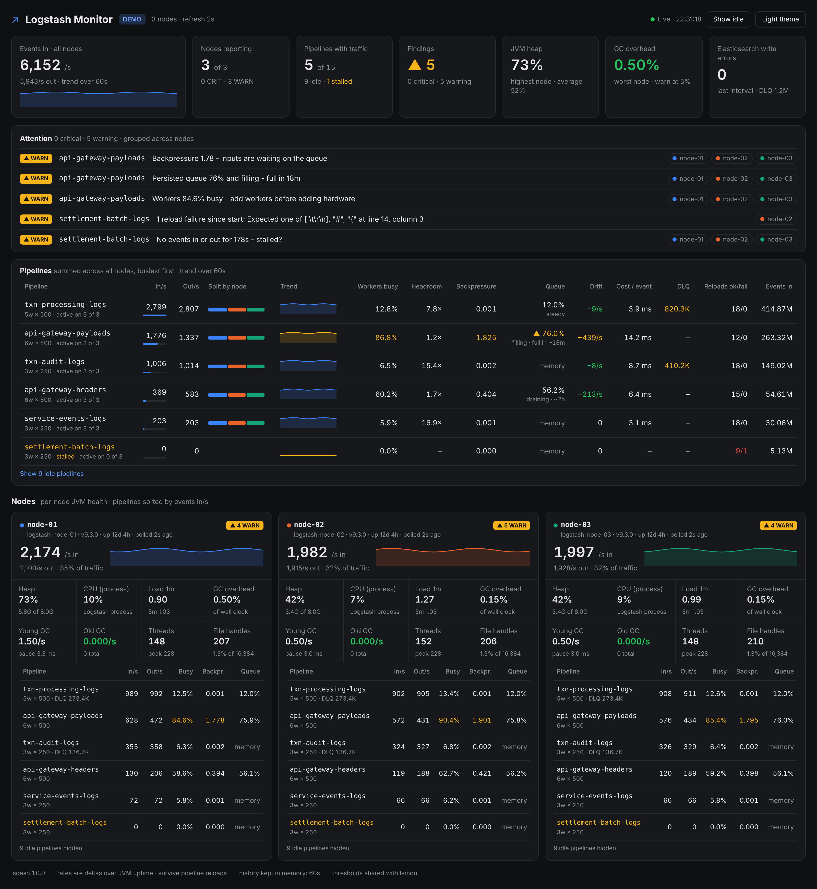

# Logstash Pipeline Monitor

**Surgical, dependency-free monitoring for Logstash pipelines.**
Two small Python files, standard library only. Copy them to any server, including air-gapped ones, and within a minute you can see which pipeline on which node is struggling, and why.

- **`lsmon`**: a terminal agent for each Logstash server. It gives a live view, a 30-second JSONL history log and findings.
- **`lsdash`**: a web dashboard for the whole fleet. It's a single page your team can open in a browser.



<sub>Demo data from the bundled mock server. There's also a [light theme](docs/dashboard-light.png), and the page works on phones.</sub>

---

## Why this exists

It was built during a production incident. A Logstash node was crashing, CPU and load were high, and the first suggestion was to add more servers. The usual monitoring stacks need agents, containers, internet access or firewall changes, and none of that was possible in time.

Logstash already exposes everything needed on its monitoring API (port `9600`). This project reads that API, turns the raw counters into real per-second rates, and answers the questions that matter under pressure:

- Is this pipeline **saturated**, or just idle?
- Are inputs **blocked** waiting on the queue?
- Is the persisted queue **filling or draining**, and how long until it's full?
- Has a pipeline silently **stalled**, or failed a **reload**?
- Is the JVM **spending its time in garbage collection** instead of processing events?

In the incident that started this, the answer was on screen within minutes. The heap was capped at 1 GB on servers with 31 GB of RAM, and one node was spending a third of its time frozen in GC. A configuration change fixed it, and no new hardware was needed.

## What it shows

| Area | Signals |
|---|---|
| **Per pipeline** | events in/out per second, worker utilisation, headroom, backpressure, persisted-queue fill with fill or drain time, drift (in − out), cost per event, dead-letter queue size, reload successes and failures, lifetime events, trend line |
| **Per node** | heap and GC (young rate, old rate, pause time, % of wall clock in GC), process CPU, load average, threads, file descriptors, share of fleet traffic |
| **Findings** | WARN and CRIT findings with plain-language explanations, grouped across nodes, so "workers 91% busy on 3 nodes" shows once rather than three times |
| **Safety** | detects Logstash restarts and pipeline reloads (counters reset) and skips that cycle rather than showing nonsense rates; flags a pipeline as **stalled** only after a sustained silence |

It's **read-only**. It never changes Logstash configuration, JVM options or pipelines.

---

## Try it in 60 seconds (no Logstash needed)

The repo includes a mock Logstash API with realistic, invented data:

```bash
git clone https://github.com/emran-hsaz/Logstash-Monitoring-UI.git
cd Logstash-Monitoring-UI

python3 tools/mock_logstash.py --port 9601 --name node-01 --heavy &
python3 tools/mock_logstash.py --port 9602 --name node-02 --flaky &
python3 tools/mock_logstash.py --port 9603 --name node-03 &

python3 lsdash.py --label DEMO \
  --node node-01=http://127.0.0.1:9601 \
  --node node-02=http://127.0.0.1:9602 \
  --node node-03=http://127.0.0.1:9603
```

Open <http://127.0.0.1:8600>. In another terminal, try the agent:

```bash
python3 lsmon.py --url http://127.0.0.1:9602 --watch
```

After a minute, the `settlement-batch-logs` pipeline is flagged as stalled. Stop everything with `kill %1 %2 %3`, or by closing the terminals.

---

## Install on a Logstash server

**Requirements:** Python 3.8+ and network access to the Logstash API (default `127.0.0.1:9600`). No `pip install` is needed, and there's nothing to download on the server.

**Air-gapped servers:** copy the repo folder (or just `lsmon.py` and `lsdash.py`) by `scp`, a jump host or removable media. Both files are plain text, so you can verify them with `sha256sum` before and after the transfer.

### Option A: just run it

```bash
python3 lsmon.py                 # one sample; run again for rates
python3 lsmon.py --watch         # live view, refreshes every 10s
```

### Option B: install with a 30-second history timer (systemd)

```bash
sudo ./deploy/install.sh                  # lsmon + timer, runs as the 'logstash' user
sudo ./deploy/install.sh --dashboard      # also install the lsdash service (not started)
sudo RUN_USER=myuser ./deploy/install.sh  # run as a different user
sudo ./deploy/install.sh --uninstall      # remove it again
```

The installer:
- puts the files in `/opt/lsmon` and creates the `lsmon` and `lsdash` commands
- logs a sample every 30s to `/var/log/lsmon/metrics.jsonl`, with daily logrotate and 14 days kept
- runs the services read-only (`ProtectSystem=strict`), with write access only to their own state and log folders

If your Logstash API needs a login, put it in `/etc/lsmon/lsmon.env` (see [`examples/lsmon.env.example`](examples/lsmon.env.example)).

---

## lsmon: terminal agent

```text
$ lsmon --cores 8
lsmon · logstash-node-02 · v9.3.0 · up 12d 4h · overall WARN

NODE   heap 39% 3.1G/8.0G   young GC 0.58/s   old GC 0.000/s   GC overhead 0.18%
       cpu 7%   load 1.21 1.00 1.01   threads 152   fds 206/16,384   in 2,112/s   out 2,041/s

PIPELINE                     IN/SEC  OUT/SEC  UTIL%  BACKPR  QUEUE%   DRIFT    COST  EVENTS IN  RELOAD
txn-processing-logs             961      964   13.2   0.001     12%      -3   3.9ms    134.59M     6/0
api-gateway-payloads            610      459   89.6   1.884     75%    +151  14.2ms     85.42M     4/0
txn-audit-logs                  345      348    6.7   0.002     mem      -3   8.7ms     48.34M     6/0
api-gateway-headers             126      200   62.1   0.417     57%     -74   6.4ms     17.72M     5/0
service-events-logs              70       70    6.1   0.001     mem       0   3.1ms      9.75M     6/0
settlement-batch-logs             0        0    0.0   0.000     mem       0       -      1.71M     3/1
+ 9 idle pipelines (use --all)

FINDINGS
WARN  [pipeline:api-gateway-payloads] Workers 89.6% busy - add workers before adding hardware
WARN  [pipeline:api-gateway-payloads] Backpressure 1.88 - inputs are waiting on the queue
WARN  [pipeline:api-gateway-payloads] Persisted queue 75% and filling - full in 20m
WARN  [pipeline:settlement-batch-logs] No events in or out for 62s - stalled?
WARN  [pipeline:settlement-batch-logs] 1 reload failure since start: Expected one of [ \t\r\n], "#", "{" at line 14, column 3
```

| Option | What it does |
|---|---|
| `--url URL` | Logstash API base URL (default `http://127.0.0.1:9600`, or `$LSMON_URL`) |
| `--watch` / `--interval N` | live view, refreshing every N seconds (default 10) |
| `--once` | one sample and exit (default). Rates need two samples, so the previous one is kept in `--state-file` |
| `--log-file FILE` | append every sample as one JSON line, which is your history |
| `--history N` | print the last N samples from `--log-file` |
| `--json` | print the full computed sample as JSON |
| `--all` | include idle pipelines |
| `--cores N` | CPU cores on the host; enables the load-per-core check |
| `--thresholds FILE` | override thresholds (see below) |
| `--quiet` | print nothing (for timers) |
| `--nagios` | exit `0/1/2/3` for OK/WARN/CRIT/unreachable, for Nagios, Zabbix or cron alerting |
| `--insecure`, `--ca-cert FILE` | TLS options for an `https` API |

Credentials are read from `LS_API_USER` and `LS_API_PASSWORD` and are never taken as command-line arguments, so they don't show up in `ps`.

**Working with the history log:**

```bash
lsmon --history 20 --log-file /var/log/lsmon/metrics.jsonl

# every CRIT sample today
grep '"overall":"CRIT"' /var/log/lsmon/metrics.jsonl | wc -l

# one pipeline's queue and backpressure over time
python3 -c '
import json
for line in open("/var/log/lsmon/metrics.jsonl"):
    d = json.loads(line)
    for p in d.get("pipelines", []):
        if p["id"] == "my-pipeline":
            print(d["timestamp"], p["queue_pct"], p["backpressure"], p["worker_util"])
'
```

Let it run for 24 hours before changing heap or worker settings. That gives you a clean "before" to compare against.

---

## lsdash: web dashboard

```bash
lsdash --node logstash-01=http://10.0.0.11:9600 --node logstash-02=http://10.0.0.12:9600
# or
lsdash --config /etc/lsmon/lsdash.json
```

See [`examples/lsdash.example.json`](examples/lsdash.example.json) for a full config, including per-node credentials.

| Option | What it does |
|---|---|
| `--node NAME=URL` | a node to poll (repeat for each node) |
| `--config FILE` | JSON config; command-line flags override it |
| `--bind ADDR` / `--port N` | listen address and port (default `127.0.0.1:8600`) |
| `--refresh S` / `--history S` | poll interval (default 2s) and in-memory trend window (default 60s) |
| `--label TEXT` | a tag next to the title, such as a site or cluster name |
| `--tls-cert` / `--tls-key` | serve over HTTPS |
| `--thresholds FILE`, `--cores N` | same as lsmon |

### Sharing it with your team

By default, lsdash listens only on `127.0.0.1`. To let others open it:

1. **Pick a port that's already allowed through your firewall.** In locked-down networks, reusing an open port is often much faster than a firewall change request. You can check whether a port is reachable before committing to it:
   ```bash
   # on the server: a throwaway listener
   python3 -m http.server 8600 --bind 0.0.0.0
   # from your workstation: open http://<server>:8600 - if it loads, the port is usable
   ```
2. **Set a login.** `LSDASH_USER` and `LSDASH_PASSWORD` turn on HTTP basic auth. lsdash warns at startup if you bind publicly without one.
3. **Add TLS where you can.** Use `--tls-cert` and `--tls-key`, because basic auth over plain HTTP sends the password readably on the network.

```bash
LSDASH_USER=ops LSDASH_PASSWORD='…' lsdash --config /etc/lsmon/lsdash.json --bind 0.0.0.0 --port 8600
```

Run it as a service with `deploy/systemd/lsdash.service`, or use `install.sh --dashboard`. `/healthz` returns `ok` without auth, for load balancers.

---

## Reading the numbers

| Signal | Healthy | What it means when it's not |
|---|---|---|
| **Old GC rate** | exactly `0.00/s` | Objects are promoted prematurely, which usually means the heap is too small. This is the single sharpest heap diagnostic. |
| **GC overhead** | under 5% | The share of wall-clock time the JVM is frozen. At 33%, a third of the node does nothing. |
| **Heap %** | anything, on its own | G1 lets the heap fill when nothing forces a collection. 86% with calm GC is fine; 86% with 25 young GCs/s is a crisis. Always read heap together with GC rate, which is why lsmon only alarms on both. |
| **Worker utilisation** | below 80% | At about 100%, the workers are the ceiling. Add `pipeline.workers` before adding hardware. |
| **Backpressure** | near 0 | Inputs are blocked waiting for queue space, so look downstream (filters and outputs). |
| **Queue % + trend** | low and steady or draining | Filling means the drain side is too slow. lsmon estimates time to full. |
| **Drift** | about 0 | In − out per second. Positive and growing means a backlog is accumulating; negative means one is clearing. |
| **Load vs CPU** | load ≈ CPU busy | High load with modest CPU means threads are runnable but not working. Check `vmstat`: `wa`≈0 points to GC contention, high `wa` to I/O. |

**Quick diagnosis:**

| You see | Check next | Likely cause |
|---|---|---|
| High heap, high GC rate | old GC rate | heap undersized |
| Old GC above 0 | GC overhead | premature promotion, so raise `-Xmx` (keep `-Xms` equal) |
| Utilisation ~100% | in/s vs out/s | worker ceiling, so add workers |
| Backpressure high, queue ~100% | utilisation | queue full, drain side too slow |
| Backpressure high, queue low | Kafka or other input health | input-side problem |
| Drift growing | utilisation and backpressure | backlog accumulating |
| Pipeline stalled | input source, `journalctl -u logstash` | upstream stopped, or the pipeline is stuck |
| Reload failures > 0 | Logstash log | bad pipeline config was pushed |
| Rates show `–` | wait one cycle | first sample, restart, or pipeline reload |

---

## Thresholds

Both tools use the same thresholds. Override any subset with a JSON file. Unknown keys are rejected, so a typo can't silently disable a check.

| Key | Default | | Key | Default |
|---|---|---|---|---|
| `heap_warn` / `heap_crit` | 75 / 85 % | | `worker_util_warn` / `_crit` | 80 / 95 % |
| `gc_young_warn` | 2.0 /s | | `backpressure_warn` / `_crit` | 1.0 / 5.0 |
| `gc_old_warn` / `gc_old_crit` | 0 / 1.0 /s | | `queue_warn` / `queue_crit` | 80 / 95 % |
| `gc_overhead_warn` / `_crit` | 5 / 10 % | | `fd_warn` | 80 % |
| `load_per_core_warn` | 1.0 | | `stall_seconds` | 60 |

```bash
lsmon --thresholds examples/thresholds.example.json
```

---

## How it works

- Polls `GET /_node/stats` and `GET /_node/pipelines`, the same API Logstash serves on port 9600 by default.
- **Rates are deltas over JVM uptime, not wall clock.** A late timer or a slow API response doesn't distort them.
- **Restarts** (uptime goes backwards or the ephemeral ID changes) and **pipeline reloads** (counters go backwards) are detected. That cycle is skipped and an INFO finding is shown instead.
- Worker utilisation, backpressure and queue growth come from Logstash's own flow metrics. On versions without them, those columns show `–` and everything else still works.
- lsdash polls all nodes in parallel and keeps a short trend history in memory only. It has no database and writes nothing to disk.

## Security notes

- Both tools only make `GET` requests to the Logstash API.
- Credentials come from environment variables or env files (mode `0640`), never from arguments.
- The lsmon state file is written with mode `0600`.
- lsdash binds to localhost by default, uses constant-time password comparison, and sends strict security headers (CSP, no framing, `nosniff`).
- Proxy environment variables are ignored for Logstash API calls, which are normally internal.

## Development

```bash
python3 -m unittest discover -s tests -v     # 22 tests, standard library only
```

The tests start mock Logstash nodes in-process and cover rate maths, restarts, reloads, stall timing, heap and GC logic, the CLI, multi-node aggregation, and dashboard auth. CI runs them on Python 3.8 to 3.13.

Contributions are welcome. Please keep the **zero-dependency** rule: anything that needs `pip install` defeats the purpose on air-gapped servers.

## License

[MIT](LICENSE)
